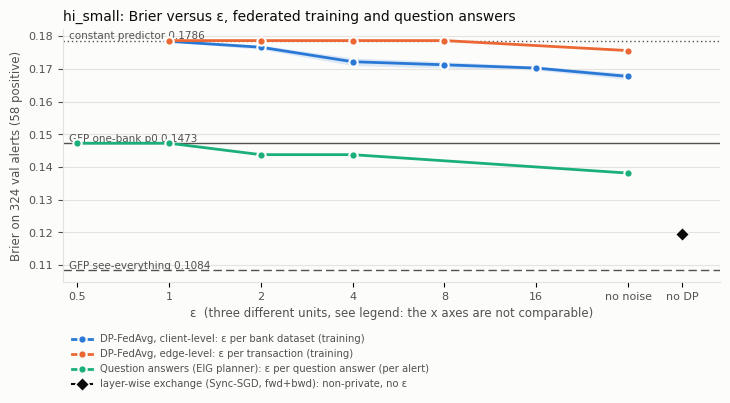
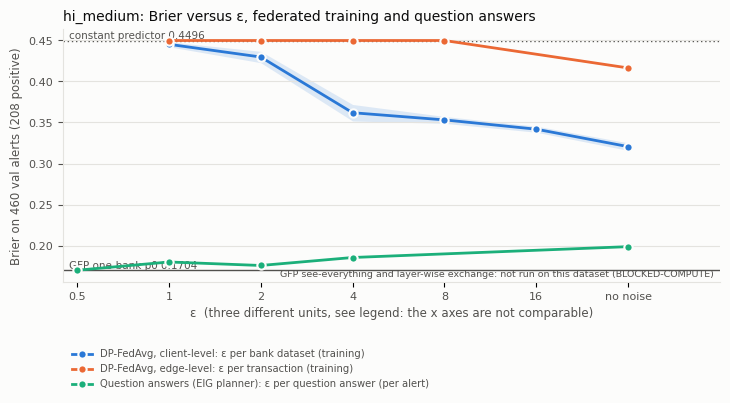

# Federated training and question answers: ε reporting and caveat text (week 11, T1)

Owner: T1 (Abhishek). Validation only (nothing on test; `FTM_FINAL_RUN` never set). Figure and numbers: `python scripts/federated_eps_figure.py --data <ds>` writes `docs/figures/t1_federated_eps_<ds>.png` and `data/runs/federated_eps_<ds>.json`. Test-ready arms and seeds: `configs/t1_final/federated.yaml`. Tracks 3.7 "done when": a Brier-versus-ε curve for federated training on val, test-ready configs, and a figure that carries every unit label and a caveat paragraph.

## Figures

Three curves share the y axis and nothing else: DP-FedAvg client-level, DP-FedAvg edge-level, and the project's per-question curve (T2's ε sweep on real data, `data/runs/eps_sweep_<ds>.json`, EIG planner with the naive fusion). The x axis is labelled with the three units, "ε per bank dataset (training)", "ε per transaction (training)" and "ε per question answer (per alert)". The constant predictor, GFP one-bank and (HI-Small only) GFP see-everything are horizontal lines. The layer-wise exchange (Sync-SGD, forward and backward exchange) is drawn at the right edge as "no DP": it exchanges node representations and adjoints at every step without any noise, so it has no ε. The y axis is the Brier score on the **same rows for every curve**: the val alerts that have a modelled partner bank (324 alerts with 58 positives on HI-Small, 460 with 208 on HI-Medium; exactly the alert set of T2's ε sweep, checked by `brier_p0` of the sweep equalling the Brier of the GFP one-bank p0 on these rows). These alerts were selected by the GFP one-bank p0, and they include the val `fit` part, which every model used to fit its calibrator or to pick its epoch (in-sample for all curves alike).

## Numbers

**hi_small** (Brier on the 324 askable val alerts, 58 positive: constant 0.1786, GFP one-bank 0.1473, GFP see-everything 0.1084; layer-wise Sync-SGD fwd+bwd, non-private, 0.1194 +- 0.0196)

| curve (unit of ε) | ε | Brier on alerts (mean +- sd, 3 seeds) | Brier on all val `eval` rows | skill vs constant on all rows |
|---|---|---|---|---|
| DP-FedAvg client-level (ε per bank dataset, training) | 1 | 0.1784 +- 0.0002 | 0.001315 | 0.002 |
| DP-FedAvg client-level (ε per bank dataset, training) | 2 | 0.1766 +- 0.0006 | 0.001306 | 0.008 |
| DP-FedAvg client-level (ε per bank dataset, training) | 4 | 0.1722 +- 0.0012 | 0.001291 | 0.020 |
| DP-FedAvg client-level (ε per bank dataset, training) | 8 | 0.1712 +- 0.0010 | 0.001281 | 0.027 |
| DP-FedAvg client-level (ε per bank dataset, training) | 16 | 0.1702 +- 0.0006 | 0.001277 | 0.030 |
| DP-FedAvg client-level (ε per bank dataset, training) | no noise | 0.1677 +- 0.0010 | 0.001267 | 0.037 |
| DP-FedAvg edge-level (ε per transaction, training) | 1 | 0.1786 +- 0.0000 | 0.001317 | -0.000 |
| DP-FedAvg edge-level (ε per transaction, training) | 2 | 0.1786 +- 0.0000 | 0.001317 | -0.000 |
| DP-FedAvg edge-level (ε per transaction, training) | 4 | 0.1786 +- 0.0000 | 0.001317 | -0.000 |
| DP-FedAvg edge-level (ε per transaction, training) | 8 | 0.1786 +- 0.0000 | 0.001317 | -0.000 |
| DP-FedAvg edge-level (ε per transaction, training) | no noise | 0.1756 +- 0.0001 | 0.001305 | 0.009 |
| Question answers, EIG planner (ε per question answer, per alert; budget) | 0.5 | 0.1473 (p0 0.1473; 0.00 questions, mean ε spent 0.00) | not defined | not defined |
| Question answers, EIG planner (ε per question answer, per alert; budget) | 1 | 0.1473 (p0 0.1473; 0.00 questions, mean ε spent 0.00) | not defined | not defined |
| Question answers, EIG planner (ε per question answer, per alert; budget) | 2 | 0.1438 (p0 0.1473; 0.50 questions, mean ε spent 0.91) | not defined | not defined |
| Question answers, EIG planner (ε per question answer, per alert; budget) | 4 | 0.1438 (p0 0.1473; 0.50 questions, mean ε spent 0.91) | not defined | not defined |
| Question answers, EIG planner (ε per question answer, per alert; budget) | no noise | 0.1381 (p0 0.1473; 2.33 questions, mean ε spent inf) | not defined | not defined |

**hi_medium** (Brier on the 460 askable val alerts, 208 positive: constant 0.4496, GFP one-bank 0.1704)

| curve (unit of ε) | ε | Brier on alerts (mean +- sd, 3 seeds) | Brier on all val `eval` rows | skill vs constant on all rows |
|---|---|---|---|---|
| DP-FedAvg client-level (ε per bank dataset, training) | 1 | 0.4451 +- 0.0030 | 0.001650 | -0.004 |
| DP-FedAvg client-level (ε per bank dataset, training) | 2 | 0.4296 +- 0.0069 | 0.001639 | 0.003 |
| DP-FedAvg client-level (ε per bank dataset, training) | 4 | 0.3619 +- 0.0100 | 0.001599 | 0.027 |
| DP-FedAvg client-level (ε per bank dataset, training) | 8 | 0.3532 +- 0.0042 | 0.001607 | 0.023 |
| DP-FedAvg client-level (ε per bank dataset, training) | 16 | 0.3418 +- 0.0037 | 0.001596 | 0.029 |
| DP-FedAvg client-level (ε per bank dataset, training) | no noise | 0.3207 +- 0.0046 | 0.001569 | 0.045 |
| DP-FedAvg edge-level (ε per transaction, training) | 1 | 0.4496 +- 0.0000 | 0.001644 | 0.000 |
| DP-FedAvg edge-level (ε per transaction, training) | 2 | 0.4496 +- 0.0000 | 0.001644 | 0.000 |
| DP-FedAvg edge-level (ε per transaction, training) | 4 | 0.4496 +- 0.0000 | 0.001644 | 0.000 |
| DP-FedAvg edge-level (ε per transaction, training) | 8 | 0.4496 +- 0.0000 | 0.001644 | 0.000 |
| DP-FedAvg edge-level (ε per transaction, training) | no noise | 0.4163 +- 0.0009 | 0.001646 | -0.002 |
| Question answers, EIG planner (ε per question answer, per alert; budget) | 0.5 | 0.1704 (p0 0.1704; 0.00 questions, mean ε spent 0.00) | not defined | not defined |
| Question answers, EIG planner (ε per question answer, per alert; budget) | 1 | 0.1804 (p0 0.1704; 0.94 questions, mean ε spent 0.90) | not defined | not defined |
| Question answers, EIG planner (ε per question answer, per alert; budget) | 2 | 0.1762 (p0 0.1704; 1.56 questions, mean ε spent 1.76) | not defined | not defined |
| Question answers, EIG planner (ε per question answer, per alert; budget) | 4 | 0.1859 (p0 0.1704; 2.22 questions, mean ε spent 3.13) | not defined | not defined |
| Question answers, EIG planner (ε per question answer, per alert; budget) | no noise | 0.1991 (p0 0.1704; 6.00 questions, mean ε spent inf) | not defined | not defined |

Federated numbers are means over seeds 0, 1, 2 (the sd is the seed sd). The column "all val `eval` rows" is the Brier of the same models on all 96,318 (HI-Small) and 320,372 (HI-Medium) bank-view rows of the val `eval` part (`ftm/baselines/README.md`); the question curve has no value there because questions exist only for alerts. The ε 1, 2 and 4 points of HI-Small and HI-Medium were rerun with `--save-p0` (`scripts/train_federated.py --eps 1 2 4 --save-p0 --tag _alerts_p0`, same code, seeds and hyper-parameters as the earlier curve) because the per-row predictions that this figure needs had only been stored for ε 8, 16 and no noise; the non-private rows of the earlier runs were kept.

## Mechanisms, units and accountants

| | DP-FedAvg client-level | DP-FedAvg edge-level | question answers |
|---|---|---|---|
| unit protected | one bank's whole dataset (30 clients, the 30 largest banks) | one transaction (a transaction between two top-30 banks sits in two clients' data) | one transaction in the asked bank's ledger (adjacent datasets differ by adding or removing a transaction) |
| mechanism | each client trains locally without a per-example mechanism, its update is clipped to norm S = 1, the 30 updates are averaged with equal weights and Gaussian noise of std σ S / 30 is added (Flower helpers) | DP-SGD per client (Opacus): Poisson sampling q = 0.02, per-example clipping C = 1, Gaussian noise σ C, 50 local steps per round; server FedAvg weighted by client train size | randomised response (yes/no), k-ary randomised response, two-sided geometric noise (counts); per-question ε from {0.25, 0.5, 1, 2} |
| accountant | Gaussian mechanism over R = 10 rounds, all clients every round (q = 1), RDP, δ = 1e-5 | subsampled Gaussian over 10 x 50 = 500 steps, RDP, **composed twice** for the two views of a transaction, δ = 1e-5 | **basic composition**: the ε of the questions asked for one alert add up to its budget (0.5, 1, 2, 4), pure ε-DP (δ = 0), plus a cap per partner account across alerts (8) |
| what ε then bounds | what the released federated model reveals about one bank's data | what it reveals about one transaction | what the answers to one alert reveal about one transaction (ratio of the answer distribution) |
| features and model | 56 features (a transaction's attributes plus past-only 24 h aggregates of its two accounts in the bank's own view), MLP with 16 hidden units (about 1,000 parameters) | 42 attributes of the transaction only (no neighbour aggregates: a message-passing GNN would break the unit) | none: the question answers update the starting p0 through a naive fusion |
| learned from | train split only | train split only | back-test of the alerts' past (T2) |

ε values of different units, different accountants and different δ are not comparable and are never added. The same number on two curves ("ε = 2") does not mean the same protection. A client-level ε covers any change of a bank's data set, so it also bounds the effect of a single transaction at that ε; the reverse does not hold (a transaction-level ε grows with the number of transactions that are changed, by group privacy, so it says little about a whole bank's data). The client-level curve therefore pays in utility for the stronger unit (the noise is calibrated to a whole data set's update), and a pure ε-DP guarantee (δ = 0) is stronger than an (ε, 1e-5) guarantee of the same ε.

## Caveat paragraph for the report

The training-time ε of the federated baselines is a guarantee about the released model for the stated privacy unit (one bank's dataset for the client-level arm, one transaction for the edge-level arm), computed by an RDP accountant at δ = 1e-5. It is not the per-question ε of the project, which bounds what the answers to the questions asked about one alert reveal about one transaction, under basic composition and δ = 0. The two quantities differ in unit, in accountant and in δ, so they are plotted on one y axis (Brier on the same alerts) with their own labelled x units and are never compared or added as numbers. Not covered by either accounting: the isotonic or Platt calibration, the epoch or step choice and the hyper-parameters, all of which use validation labels (the federated hyper-parameters were fixed, not tuned, and the calibrator is one 2-parameter Platt fit on the pooled val `fit` rows); and, in the edge-level arm, the server weights, which use the clients' train sizes (treated as public). The client-level guarantee holds for any model because local training is non-private and only the clipped, noised update is released; the edge-level guarantee holds only because the model sees nothing but the transaction's own attributes, which on these data carry almost no laundering signal (non-private Brier skill 0.009 on HI-Small, -0.002 on HI-Medium), so its curve is the constant predictor at every ε. Results cover HI-Small and HI-Medium on validation; the layer-wise exchange is a non-private reference without an ε, run on HI-Small only.

## What H10 can and cannot say

H10 (secondary, `prereg/hypotheses.yaml`): "private questions match or beat DP federated training on Brier at a comparable privacy level", statistic Brier(ours) minus Brier(DP-FedAvg), rejection if the upper CI bound is below the equivalence margin.

- **Can say** (descriptive, on validation): at no ε does a DP federated model reach the starting model. On HI-Small the best client-level model, even without noise, has Brier 0.168 on the alerts against 0.147 for the GFP one-bank p0 and 0.179 for the constant; the edge-level curve is the constant at every ε. On HI-Medium the corresponding numbers are 0.321 (client-level, no noise), 0.416 (edge-level, no noise), 0.170 (p0) and 0.450 (constant). Read at the same numeric ε the question curve is below the federated curves on both datasets (HI-Small at ε 2: 0.144 against 0.177 client-level and 0.179 edge-level; HI-Medium at ε 2: 0.176 against 0.430 and 0.450), so the sign of H10's difference is negative at every matched number. The same figure also shows that this is a weak comparison by construction: the federated model is a 1,000-parameter MLP on 14 aggregates, not the GBT that produces p0, and a model that cannot beat p0 is not a competitor for what the questions are meant to improve.
- **Cannot say**: that the privacy levels are comparable. No mapping between ε per bank dataset, ε per transaction and ε per question answer exists in this project, so "comparable privacy level" can only be read as "the same numeric ε", which is a convention and not a privacy statement; the report should say so next to the result and show the figure, not only the difference. On HI-Medium the question curve is itself above p0 at every budget of 1 or more (the naive fusion moves p0 the wrong way on the real likelihood ratios, G2 not met, `docs/t1_baselines_val.md` and STATUS), so there "ours beats federated" means "a worse-than-p0 update beats a much worse model". On HI-Small only 0.5 questions per alert are accepted at budget 2 (0 at budgets 0.5 and 1), the gain over p0 is 0.0035 Brier. No CI of the difference is computed here: the 324 and 460 alerts are partly in-sample for the calibrators, and the equivalence margin is `fix_on_val` for T4. The test-set H10 statistic comes from T4's run and the test-ready arms in `configs/t1_final/federated.yaml`.
